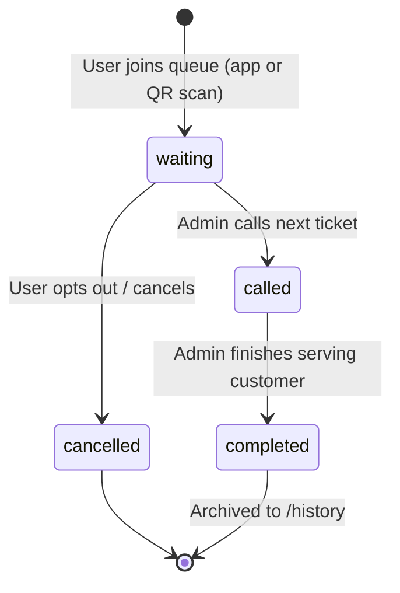
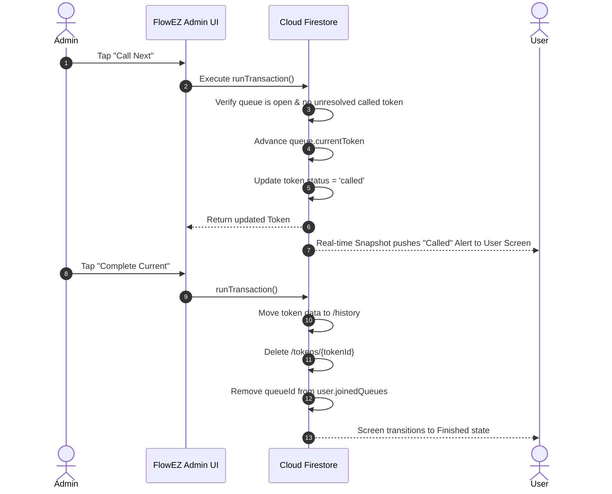

# FlowEZ — Smart Queue Management System

[](https://flutter.dev)
[](https://dart.dev)
[](https://firebase.google.com)
[](LICENSE)
[](https://flutter.dev)

> **FlowEZ** is a modern, real-time queue and token management application built with **Flutter** and **Firebase**. It bridges physical waiting spaces with seamless digital queues, allowing administrators to manage queues and analyze footfall in real-time, while empowering customers to join queues remotely or via instant QR code scans, track their live queue status, and eliminate waiting room friction.

---

## 📌 Table of Contents

- [✨ Key Features](#-key-features)
  - [👤 User / Customer Experience](#-user--customer-experience)
  - [🛡️ Admin & Operator Operations](#️-admin--operator-operations)
  - [📊 Analytics & Business Intelligence](#-analytics--business-intelligence)
  - [🎨 Design & Theming](#-design--theming)
- [🏗️ System Architecture](#️-system-architecture)
- [🔄 Core Workflows & State Machines](#-core-workflows--state-machines)
- [🗄️ Firestore Database Schema](#️-firestore-database-schema)
- [🔒 Security Rules & Indexes](#-security-rules--indexes)
- [📁 Project Directory Structure](#-project-directory-structure)
- [🚀 Getting Started & Setup Guide](#-getting-started--setup-guide)
  - [1. Prerequisites](#1-prerequisites)
  - [2. Clone the Repository](#2-clone-the-repository)
  - [3. Install Dependencies](#3-install-dependencies)
  - [4. Firebase Configuration](#4-firebase-configuration)
  - [5. Platform Configuration](#5-platform-configuration)
  - [6. Deploy Firestore Rules & Indexes](#6-deploy-firestore-rules--indexes)
- [💻 Running & Building](#-running--building)
- [🧪 Testing](#-testing)
- [🛠️ Tech Stack & Dependencies](#️-tech-stack--dependencies)
- [🛡️ Concurrency & System Reliability](#️-concurrency--system-reliability)
- [🤖 AI Usage & Engineering Transparency](#-ai-usage--engineering-transparency)
- [🔮 Future Roadmap](#-future-roadmap)
- [❓ Troubleshooting & FAQ](#-troubleshooting--faq)
- [📄 License & Authors](#-license--authors)

---

## ✨ Key Features

### 👤 User / Customer Experience
- **Instant Queue Discovery & Search:** Browse active queues with real-time status indicators (Open / Closed) and search queues instantly by name.
- **Dynamic QR Code Scanner:** Point and scan queue QR codes using device cameras (`mobile_scanner`) to fetch queue details and join instantly.
- **Live Token Tracker:**
  - View current serving token vs. user token number.
  - Live count of users ahead in queue and estimated wait times.
  - Reactive status updates (`waiting` ➔ `called` ➔ `completed`).
- **Token Cancellation:** Option for users to cancel their active ticket if plans change, automatically recalculating queue wait metrics.
- **Historical Records:** Complete history ledger displaying past completed and cancelled visits with elapsed wait durations and timestamps.
- **User Profile Management:** Edit display name, change account passwords, and review joined queue statistics.

### 🛡️ Admin & Operator Operations
- **Dedicated Admin Dashboard:**
  - Real-time KPI summary (Active Queues, Open Queues, Closed Queues, Total Waiting Users).
  - List of managed queues with instant status controls.
- **Queue Management Suite:**
  - **Create Queues:** Set custom queue names, descriptions, and operational defaults.
  - **Open / Close Toggle:** Temporarily halt incoming ticket generation without interrupting currently queued customers.
  - **Call Next Customer:** Atomic Firestore transactions increment the current token and transition the next waiting user to `called`.
  - **Complete Customer:** Conclude service for the current ticket and log it to historical records.
  - **Delete Queue:** Cascading cleanup that removes active tokens, logs history, and clears user references.
- **Branded QR Generator & Exporter:**
  - High-resolution, branded vector QR codes (`pretty_qr_code`).
  - **Save to Gallery:** Save QR images directly to the device photo library using `gal`.
  - **Share QR:** Share QR codes directly to apps, printers, or messaging platforms via `share_plus`.

### 📊 Analytics & Business Intelligence
- **Interactive Multi-Timeframe Filtering:** Switch between **Today**, **Past 7 Days (Week)**, and **Past 30 Days (Month)**.
- **Deep Metrics & Trends:**
  - Serving efficiency and average wait durations.
  - Throughput counts per queue.
  - Peak flow hours detection.
- **Data Visualizations (`fl_chart`):**
  - **Bar Charts:** Customer volume comparison across active queues.
  - **Line Charts:** Hourly footfall trends and throughput timelines.
  - **Pie Charts:** Token status distributions (Completed vs. Cancelled vs. Waiting).
- **Exporting Capabilities:**
  - Instant **CSV Report Preview** for external spreadsheet ingestion.
  - Formatted **PDF Summary Preview** for stakeholder review.

### 🎨 Design & Theming
- Fully compatible with **Material Design 3 (M3)**.
- **Dual Theme Support:** Dedicated Light and Dark themes engineered with accessible contrast ratios (`AppColors`).
- **Theme Persistence:** Mode selection (Light, Dark, System) remembered across app sessions via `shared_preferences`.

---

## 🏗️ System Architecture

FlowEZ follows a clean, reactive architecture with clear separation of concerns:

```
┌────────────────────────────────────────────────────────┐
│                    Presentation Layer                  │
│       Screens (Admin / User / Auth) & UI Widgets       │
└───────────────────────────▲────────────────────────────┘
                            │ (Consumes State)
┌───────────────────────────┴────────────────────────────┐
│                  State Management Layer                │
│    AuthProvider  │  QueueProvider  │  UserProvider     │
│                 ThemeProvider                          │
└───────────────────────────▲────────────────────────────┘
                            │ (Calls Business Logic)
┌───────────────────────────┴────────────────────────────┐
│                      Service Layer                     │
│    AuthService   │  QueueService   │  QRService        │
│              NotificationService                       │
└───────────────────────────▲────────────────────────────┘
                            │ (Cloud Streams & Transactions)
┌───────────────────────────┴────────────────────────────┐
│                    Cloud Firestore                     │
│    /users       │  /queues   │  /tokens   │  /history  │
└────────────────────────────────────────────────────────┘
```

---

## 🔄 Core Workflows & State Machines

### 1. Customer Token Lifecycle


### 2. Live Queue Calling & Transaction Flow


---

## 🗄️ Firestore Database Schema

The database relies on 5 primary collections:

```
cloud_firestore
 ├── users/
 │    └── {userId}
 │         ├── uid: string
 │         ├── name: string
 │         ├── email: string
 │         ├── role: "admin" | "customer" | "user"
 │         ├── joinedQueues: array<string>
 │         └── createdAt: timestamp
 │
 ├── queues/
 │    └── {queueId}
 │         ├── queueId: string
 │         ├── name: string
 │         ├── description: string
 │         ├── status: "open" | "closed" | "active" | "inactive"
 │         ├── currentToken: number
 │         ├── lastToken: number
 │         ├── createdBy: string (admin uid)
 │         ├── nameSearchKey: string (lowercase for querying)
 │         └── createdAt: timestamp
 │
 ├── tokens/
 │    └── {tokenId}
 │         ├── tokenId: string
 │         ├── queueId: string
 │         ├── userId: string
 │         ├── tokenNumber: number
 │         ├── status: "waiting" | "called" | "cancelled"
 │         └── joinedAt: timestamp
 │
 ├── history/
 │    └── {historyId}
 │         ├── historyId: string
 │         ├── queueId: string
 │         ├── userId: string
 │         ├── tokenNumber: number
 │         ├── durationMinutes: number (optional)
 │         └── completedAt: timestamp
 │
 └── notifications/
      └── {notificationId}
           ├── notificationId: string
           ├── userId: string
           ├── title: string
           ├── message: string
           ├── read: boolean
           └── createdAt: timestamp
```

---

## 🔒 Security Rules & Indexes

### Firestore Security Rules Summary
- **Users (`/users/{userId}`)**:
  - `create`: Owner only.
  - `read`, `update`: Owner or Admin.
  - `delete`: Denied.
- **Queues (`/queues/{queueId}`)**:
  - `read`: Authenticated users.
  - `create`: Admin only.
  - `update`: Admin or queue creator.
  - `delete`: Denied via single write (handled through transaction cascade).
- **Tokens (`/tokens/{tokenId}`)**:
  - `read`: Token owner or Queue creator / Admin.
  - `create`: Signed-in user creating their own token.
  - `update`: Queue manager or Admin.
- **History (`/history/{historyId}`)**:
  - `read`: Token owner or Queue manager.
  - `create`: Queue manager on completion.
  - `update`, `delete`: Denied (immutable audit record).

> [!TIP]
> The full production security rules are located in [firestore.rules](firestore.rules) and pre-configured composite indexes are stored in [firestore.indexes.json](firestore.indexes.json).

---

## 📁 Project Directory Structure

```text
flowezV3/
├── android/                   # Native Android host & Gradle Kotlin DSL
├── ios/                       # Native iOS project & CocoaPods configuration
├── lib/
│   ├── core/
│   │   ├── constants/         # Colors, typography, strings, dimensions
│   │   ├── routes/            # AppRoutes & navigation route generator
│   │   ├── theme/             # Light & Dark themes, ThemeProvider
│   │   └── widgets/           # Global design system components & buttons
│   ├── models/                # Typed data models with JSON/Firestore serialization
│   │   ├── notification_model.dart
│   │   ├── queue_model.dart
│   │   ├── token_model.dart
│   │   └── user_model.dart
│   ├── providers/             # State management (Provider)
│   │   ├── auth_provider.dart
│   │   ├── queue_provider.dart
│   │   └── user_provider.dart
│   ├── screens/
│   │   ├── admin/             # Admin console, queue manager, QR & analytics
│   │   │   ├── widgets/       # Metric cards, fl_chart visualizations
│   │   │   ├── analytics_screen.dart
│   │   │   ├── create_queue_screen.dart
│   │   │   ├── dashboard_screen.dart
│   │   │   ├── manage_queue_screen.dart
│   │   │   └── queue_qr_screen.dart
│   │   ├── auth/              # Login, Sign Up, Password Reset
│   │   ├── user/              # User Home, Live Token, History, Profile, QR Scanner
│   │   ├── app_initialization_error_screen.dart
│   │   └── splash_screen.dart
│   ├── services/              # Firebase & hardware service layers
│   │   ├── auth_service.dart
│   │   ├── notification_service.dart
│   │   ├── qr_service.dart
│   │   └── queue_service.dart
│   └── main.dart              # App bootstrap & provider assembly
├── test/                      # Unit and route testing
├── firestore.rules            # Firebase Security Rules
├── firestore.indexes.json     # Firebase Composite Query Indexes
└── pubspec.yaml               # Dependencies & assets configuration
```

---

## 🚀 Getting Started & Setup Guide

### 1. Prerequisites
Ensure the following tools are installed on your machine:
- [Flutter SDK](https://docs.flutter.dev/get-started/install) (`v3.12.2` or later)
- [Dart SDK](https://dart.dev/get-dart) (`^3.12.2`)
- [Java Development Kit (JDK)](https://adoptium.net/) (JDK 17 recommended)
- [Android Studio](https://developer.android.com/studio) or [VS Code](https://code.visualstudio.com/) with Flutter extensions
- [Firebase CLI](https://firebase.google.com/docs/cli) (`npm install -g firebase-tools`)

Run `flutter doctor` to verify your environment setup:
```bash
flutter doctor
```

### 2. Clone the Repository
```bash
git clone https://github.com/<your-username>/flowez.git
cd flowez
```

### 3. Install Dependencies
```bash
flutter pub get
```

### 4. Firebase Configuration
FlowEZ requires Firebase Authentication and Cloud Firestore:

1. Create a Firebase project in the [Firebase Console](https://console.firebase.google.com/).
2. Enable **Authentication** and activate the **Email/Password** sign-in provider.
3. Enable **Cloud Firestore Database** in your chosen region.
4. Download and configure platform configuration files:
   - **Android**: Place `google-services.json` inside `android/app/`.
   - **iOS**: Place `GoogleService-Info.plist` inside `ios/Runner/` via Xcode.
   - Alternatively, configure using the official FlutterFire CLI:
     ```bash
     dart pub global activate flutterfire_cli
     flutterfire configure
     ```

### 5. Platform Configuration

#### Android Permissions
Ensure `android/app/src/main/AndroidManifest.xml` includes camera and storage permissions for QR scanning and saving:
```xml
<uses-permission android:name="android.permission.INTERNET"/>
<uses-permission android:name="android.permission.CAMERA"/>
<uses-permission android:name="android.permission.WRITE_EXTERNAL_STORAGE" android:maxSdkVersion="28"/>
<uses-permission android:name="android.permission.READ_EXTERNAL_STORAGE"/>
```

#### iOS Permissions
Add the following keys to `ios/Runner/Info.plist`:
```xml
<key>NSCameraUsageDescription</key>
<string>FlowEZ requires camera access to scan queue QR codes.</string>
<key>NSPhotoLibraryAddUsageDescription</key>
<string>FlowEZ requires access to your photo library to save queue QR codes.</string>
```

### 6. Deploy Firestore Rules & Indexes
Authenticate with Firebase CLI and deploy the rules and composite indexes:
```bash
firebase login
firebase use --add <your-firebase-project-id>
firebase deploy --only firestore
```

---

## 💻 Running & Building

### Run in Debug Mode
Connect a physical device or launch an emulator/simulator, then execute:
```bash
# Auto-detect device
flutter run

# Run on a specific target
flutter run -d chrome
flutter run -d android
flutter run -d ios
```

### Provisioning an Admin User
By default, new users signing up through the app are assigned the `customer` or `user` role.
To grant an account administrator privileges:
1. Register a new user in the app.
2. In the [Firebase Console](https://console.firebase.google.com/), open **Firestore Database** ➔ `users`.
3. Locate the user document corresponding to your `uid`.
4. Update the `role` field value from `user` to `admin`.
5. Restart the app or log in again; the splash screen router will automatically navigate you to the **Admin Dashboard** (`/admin/dashboard`).

### Build for Production

#### Android APK
```bash
flutter build apk --release
```

#### Android App Bundle (Google Play Store)
```bash
flutter build appbundle --release
```

#### iOS IPA (Requires macOS & Xcode)
```bash
flutter build ipa --release
```

---

## 🧪 Testing

Execute the unit and widget test suite:
```bash
flutter test
```

Run static analysis to check for code smells and linter compliance:
```bash
flutter analyze
```

---

## 🛠️ Tech Stack & Dependencies

| Category | Technology / Package | Purpose |
| :--- | :--- | :--- |
| **Framework** | [Flutter](https://flutter.dev) | Cross-platform UI toolkit |
| **Language** | [Dart](https://dart.dev) | Client-optimized, object-oriented language |
| **State Management**| [Provider](https://pub.dev/packages/provider) | Dependency injection & reactive state |
| **Backend & Auth** | [Firebase Auth](https://pub.dev/packages/firebase_auth) | User authentication & credential management |
| **Realtime Database**| [Cloud Firestore](https://pub.dev/packages/cloud_firestore) | Realtime database, streams & atomic transactions |
| **QR Code Creation** | [pretty_qr_code](https://pub.dev/packages/pretty_qr_code) | Customized, stylized QR code rendering |
| **QR Code Scanner** | [mobile_scanner](https://pub.dev/packages/mobile_scanner) | High-performance native barcode & QR scanner |
| **Data Analytics** | [fl_chart](https://pub.dev/packages/fl_chart) | Dynamic bar, line, and pie chart visualizations |
| **Media & Gallery** | [gal](https://pub.dev/packages/gal) | Direct saving of generated QR codes to device albums |
| **Sharing** | [share_plus](https://pub.dev/packages/share_plus) | Native OS share sheet integration |
| **Preferences** | [shared_preferences](https://pub.dev/packages/shared_preferences) | Persistent local storage (theme, settings) |
| **Typography** | [google_fonts](https://pub.dev/packages/google_fonts) | Custom modern typography |

---

## 🛡️ Concurrency & System Reliability

- **Race-Condition Prevention:** FlowEZ uses atomic Cloud Firestore transactions (`runTransaction`) for token creation, advancing the queue, and completing service tickets. This guarantees that concurrent users requesting tokens at the same millisecond never receive duplicate numbers.
- **Resilient Error Recovery:** The app implements specialized initialization guards and network exception handling (`SocketException`, `FirebaseException`) with user-friendly retry banners and fallback states.

---

## 🤖 AI Usage & Engineering Transparency

- AI was utilized during the development lifecycle primarily as an engineering copilot for architectural exploration, diagnosing low-level Flutter/Gradle compatibility errors, and refining state management patterns.
- **Predictive Wait Times:** Machine-learning-based dynamic wait-time estimation was evaluated. It is planned for future releases once sufficient real-world historical queue turnaround data is gathered to train an accurate predictive model.

---

## 🔮 Future Roadmap

- [ ] **AI-Powered Predictive Wait Times:** Train regression models on historical throughput to forecast queue wait durations accurately.
- [ ] **Push Notifications:** Firebase Cloud Messaging (FCM) integration for real-time background push alerts when a customer's turn is approaching.
- [ ] **Multi-Counter & Department Routing:** Support for multi-desk service stations within a single establishment.
- [ ] **SMS / WhatsApp Token Fallback:** Allow users without smartphones or the app installed to receive updates via standard SMS web links.

---

<details>
<summary><b>1. App stuck on "Initialization Error" or "Firestore not available"</b></summary>
<br>
This indicates that Firebase failed to initialize on startup. Verify that:
- Your <code>google-services.json</code> is placed under <code>android/app/</code>.
- For iOS, <code>GoogleService-Info.plist</code> is linked inside Xcode.
- The device or emulator has an active internet connection.
</details>

<details>
<summary><b>2. QR Scanner opens to a blank screen or crashes</b></summary>
<br>
Ensure camera permissions are requested and granted in your app settings. On physical Android/iOS devices, check that camera access hasn't been denied in the system settings.
</details>

<details>
<summary><b>3. Missing composite index error when calling next or querying tokens</b></summary>
<br>
Cloud Firestore requires multi-field indexes for queries that filter by status and order by token number. Make sure you deploy the indexes file:
<pre>firebase deploy --only firestore:indexes</pre>
Or click the direct URL logged in the console to auto-create the missing index in the Firebase console.
</details>

<details>
<summary><b>4. How do I enable Dark Mode?</b></summary>
<br>
Navigate to the user home or profile screen and tap the theme toggle button. Your preference will automatically be saved and persist across restarts.
</details>

---

## 📄 License & Authors

Distributed under the MIT License. See `LICENSE` for more information.

Developed with ❤️ using Flutter and Firebase. Contributions, issues, and feature requests are welcome!
